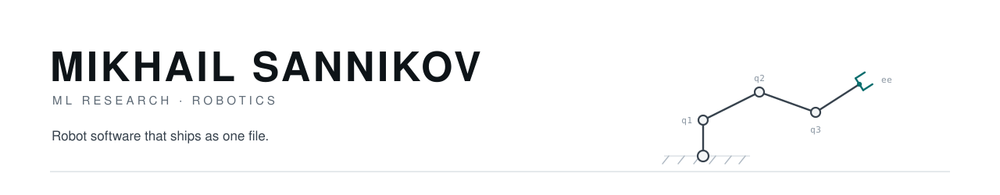

<picture>
  <source media="(prefers-color-scheme: dark)" srcset="https://raw.githubusercontent.com/msannikov03/msannikov03/main/assets/header-dark.svg">
  
</picture>

I build robot learning systems end to end: the rig, the data, the policy, and the deployment on the robot.

---

### Research

| | | |
|---|---|---|
| **[HapticWAM](https://arxiv.org/abs/2609.23888)** | submitted to ICRA 2027 · co-first author | a world-action model on a frozen Cosmos video diffusion transformer, distilled into a student policy that needs no tactile sensors at runtime; 77% mean success on three real contact-rich tasks. [code](https://github.com/Advanced-Robotic-Manipulation/HapticWAM) · [models & data](https://huggingface.co/collections/armteam/hapticwam-icra-2027-6ab234bdfe24c383b5f9fb57) |
| **[HapticVLA](https://arxiv.org/abs/2603.15257)** | IEEE/RSJ IROS 2026 · co-first author | SmolVLA policies fine-tuned with reward-weighted flow matching, 15 Hz on a Jetson Orin NX, 86.7% mean success on contact-rich tasks. [code](https://github.com/Advanced-Robotic-Manipulation/crab) · [dataset](https://huggingface.co/datasets/armteam/crab-manipulation-dataset) |
| **[CloudDiffusion](https://arxiv.org/abs/2606.16048)** | IEEE SMC 2026 · co-first author | diffusion-based 3D LiDAR point-cloud scene completion on SemanticKITTI, single denoising step at 209 ms/frame. [weights](https://huggingface.co/businesslion/clouddiffusion) |

---

### Projects

**[Caliper](https://github.com/msannikov03/caliper)** — one deterministic Rust core for serial-arm robotics,
published as **17 crates** and exposed through three faces that share the exact same code:
a CLI, a Python module built with maturin, and *Caliper Studio*, a Tauri + React desktop
app with a 3D scene and a Simulink-style dataflow editor. Forward and inverse kinematics, dynamics,
collision, planning, trajectory optimization and MuJoCo contact sim all sit behind one
API, so the shell, the notebook and the GUI can't drift apart. Ships as an 11 MB signed
and notarized dmg with the physics inside — no ROS workspace, no GPU, no cloud.

&nbsp;&nbsp;&nbsp;&nbsp;`crates.io` · `Apache-2.0` · [docs](https://msannikov03.github.io/caliper/) · `cargo install caliper-cli` · `pip install caliper-robotics`

**Ratchet** (private, with Ilya Mikhalchuk) — a self-improving agent harness for robots: an LLM planner and perception over a growing
library of tested skills, with failures turned into new ones. Tested on the LIBERO-PRO and RoboDojo benchmarks; real SO-101 arms are next.

**[physprobe](https://github.com/msannikov03/physprobe)** — do frozen video models see hidden object physics? Linear probes on V-JEPA 2, DINOv2 and the
Cosmos tokenizer over MuJoCo push clips. V-JEPA 2 recovers mass and friction almost perfectly; the Cosmos tokenizer does noticeably worse, especially on friction.

**[printfarm-sim](https://github.com/msannikov03/printfarm-sim)** — a MuJoCo simulation of a robot-tended 3D-print farm: doors, grasping, raking, bed-to-box packing, fleet model.

**[semantic_pf_loc](https://github.com/msannikov03/semantic_pf_loc)** — camera localization inside a 3D Gaussian Splatting map: particle filter plus differentiable rendering.

---

### Currently

Robot learning for contact-rich manipulation: world-action models, VLA policies, tactile-conditioned
training, and getting the deploy path to behave like the training path.
B.S. Mechanical Engineering, major in Robotics & Mechatronics, Virginia Tech, summa cum laude.
Open to robot learning and robotics engineering roles.

---

**[sannikov.club](https://sannikov.club)** · [LinkedIn](https://linkedin.com/in/mikhailsannikov) · [Google Scholar](https://scholar.google.com/citations?user=7cfCv6wAAAAJ) · [msannikov03@gmail.com](mailto:msannikov03@gmail.com)
